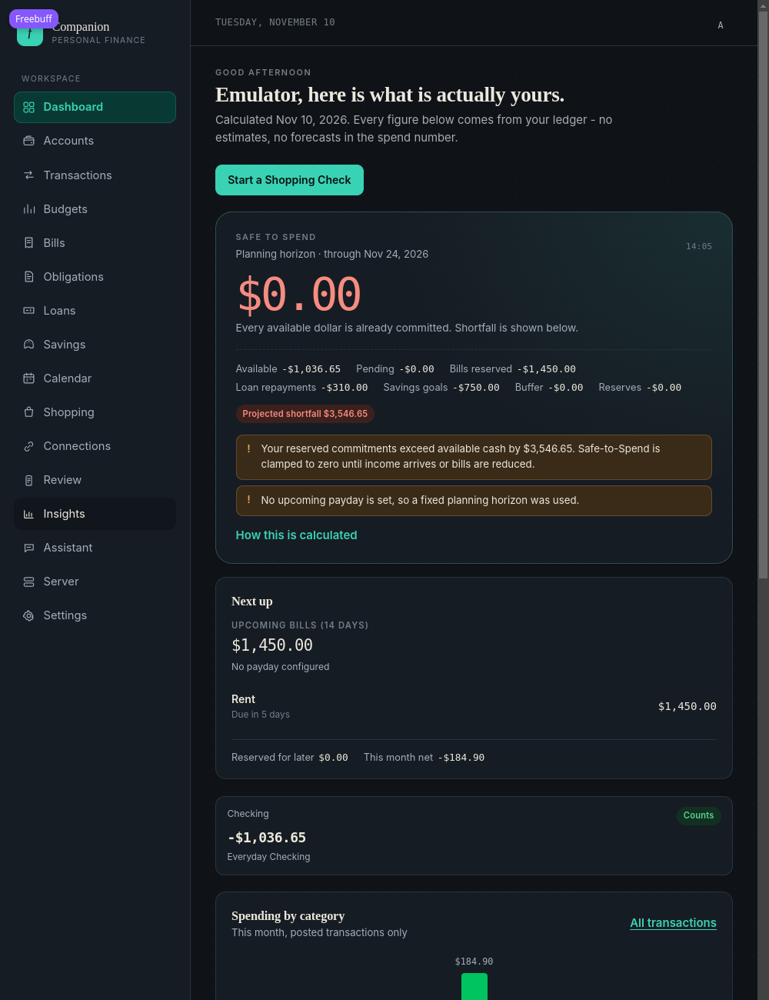
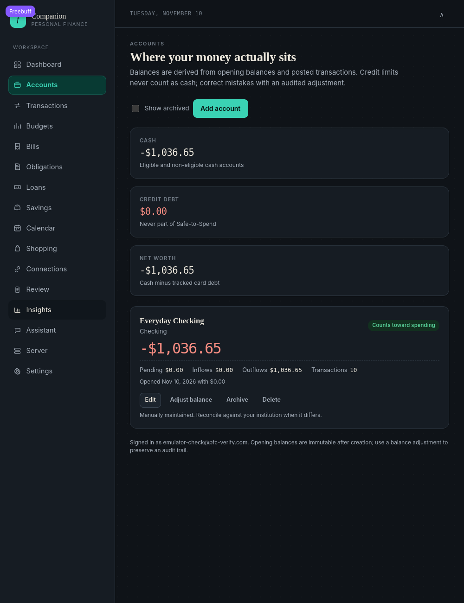
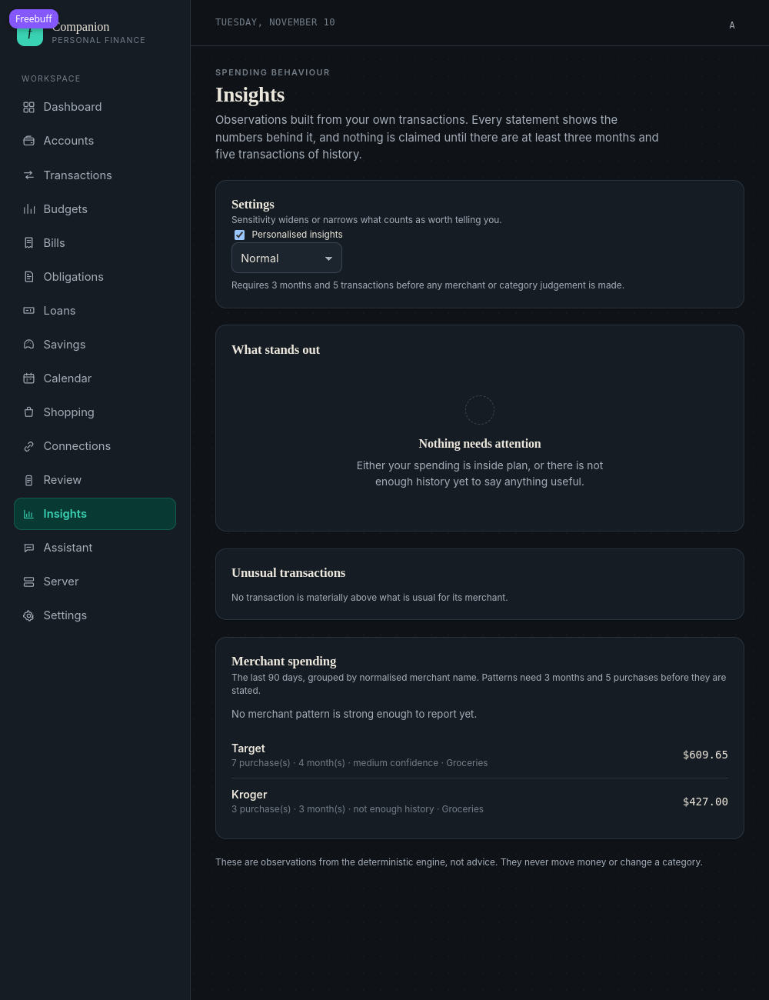
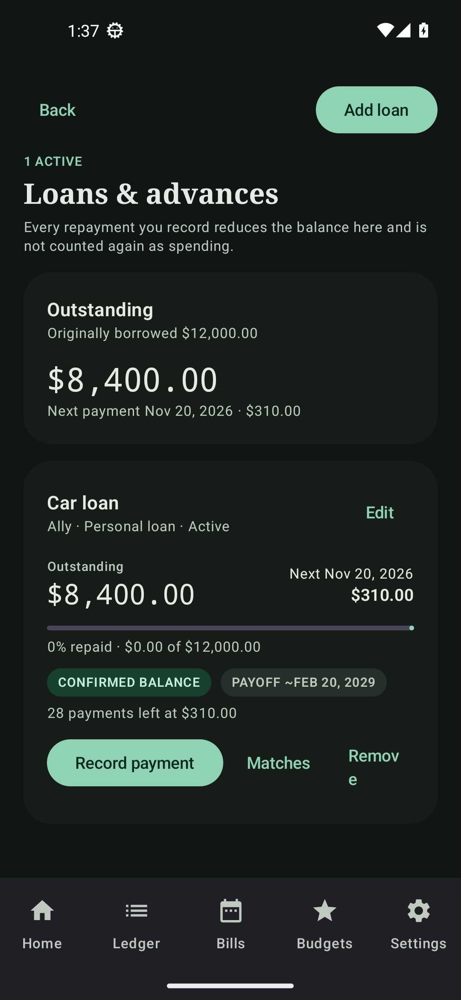
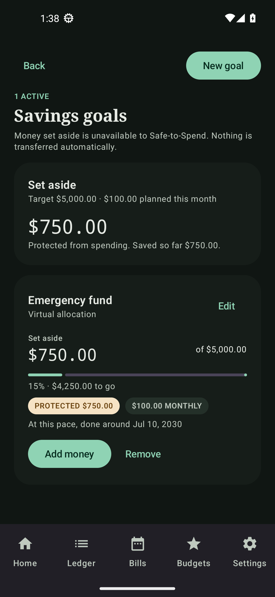
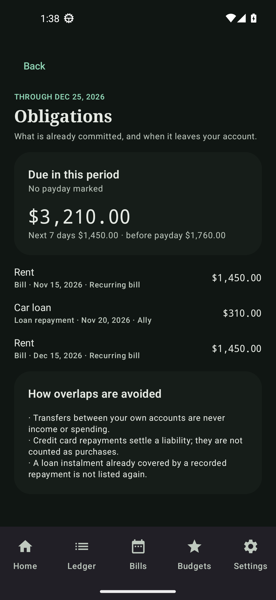

# Acceptance report — Phase 4: Financial Intelligence Expansion

Date: 2026-11-10 · Server version **2.1.0** · Android **0.6.0** (versionCode 8)

This report describes what was actually implemented, what was executed, and what was not
verified. Nothing below is claimed as tested unless the command or check is named.

---

## 1. Existing functionality reused

The phase extends the system that already existed; no subsystem was rewritten and no data was
reset.

| Existing piece | Reused for |
| --- | --- |
| `FinancialAccount`, `include_in_safe_to_spend`, balance lookup | Eligible spending balances, excluded savings accounts, credit-card liabilities |
| `Transaction` (purchase/posted/transfer), `normalize_merchant()` | Merchant grouping, repayment candidates, store budgets |
| `Bill` occurrences + `horizon_candidates()` | Bill obligations and reserves |
| `IncomeSource`, `next_payday_date()` | Payday horizon, obligations cash flow |
| `Budget`, `budget_category_row()` | Category pressure findings, category availability |
| `Reserve`, `UserPreference` | Explicit reserves, pending-debits switch, auto-match threshold |
| `MatchStatus` and the bill-matching pattern | Loan repayment suggestions/confirm/reject |
| `SafeToSpendResult` | Extended, not replaced, with loans/savings/cards/obligations |
| Shopping Check tracked-place screen | The location feature lives inside it, not beside it |
| `ProviderConfig` administration (Phase 3) | Untouched by this phase |

New tables: `loans`, `loan_payments`, `savings_goals`, `savings_contributions`,
`insight_dismissals`, `tracked_locations`, `shopping_visits`. New nullable columns:
`financial_accounts.minimum_payment` and the location/notification settings on
`notification_preferences`.

## 2. New functionality implemented

- **Loans & Advances** — all loan types, derived balances, principal/interest/fee splits,
  estimate flags, payoff projection, repayment history, transaction matching with confidence
  and ambiguity handling.
- **Unified obligations** — bills + loan instalments + typed card minimums, overdue and
  due-before-payday totals, income reported separately, staleness warning.
- **Savings goals** — virtual vs account-backed, contribution schedules, protection maths that
  deducts a dollar at most once, summary totals.
- **Safe-to-Spend breakdown** — loan, savings, credit-card and obligation reserves, an
  `explanation` line list produced by the calculating function, `stale_information`.
- **Merchant intelligence** — profiles over 90-day windows with a prior-window comparison,
  four finding types, evidence objects, dismiss/restore, 3-month/5-purchase floor.
- **Recommendations** — structured items (`cash`, `obligation`, `loan`, `savings`, `category`,
  `merchant`, `data`) with facts, confidence, period and data freshness.
- **Location-aware Shopping Check** — consent settings, geofence monitoring, low-power
  discovery, places-provider abstraction, visit history with retention/deletion, notification
  gating (quiet hours, cooldown, per-place, pause).
- **Clients** — web pages for Loans, Savings, Obligations, plus Shopping Intelligence settings
  and merchant insights; Android screens for Loans, Savings, Obligations, Shopping
  Intelligence, plus geofence/activity/boot receivers.

## 3. Database changes

One migration, applied to the live database during this phase:

```
3f2c9a71b4d8 -> b7e4c1d92f30, Phase 4: loans, savings goals, shopping locations and visits.
```

`alembic_version` in the running database now reads `b7e4c1d92f30`. The migration adds seven
tables and two **nullable** columns (`financial_accounts.minimum_payment`, plus notification
settings on `notification_preferences`), so no existing row had to change and nothing was
backfilled. It is reversible: the downgrade drops the new tables and columns.

## 4. Docker services, images, status

Deployment: `deploy/docker/compose.yaml` (local image tags, no `latest`).

| Service | Container | Ports | Status at time of writing |
| --- | --- | --- | --- |
| `db` (postgres:17-alpine) | `pfc-db-1` | `5432/tcp` internal only | Up, healthy |
| `api` (`pfc-api:2.1.0`, default tag in `compose.yaml`) | `pfc-api-1` | `8000/tcp` internal only | Up, healthy (rebuilt this phase) |
| `worker` (same image) | `pfc-worker-1` | `8000/tcp` internal only | Up, healthy (rebuilt this phase) |
| `web` (`pfc-web:2.1.0`) | `pfc-web-1` | `80/tcp` internal only | Up, healthy (rebuilt this phase) |
| `caddy` (`caddy:2.8-alpine`) | `pfc-caddy-1` | `0.0.0.0:8088->80`, `0.0.0.0:8448->443` | Up, healthy |

Volumes: `pfc_db-data` (database), `pfc_caddy-data`, `pfc_caddy-config` (certificates and
proxy state). Only Caddy publishes ports; the database and both application services are
reachable only inside the compose network.

## 5. Server discovery / configuration endpoint

`GET /api/v1/server/info` (public, read-only) on the live stack:

```json
{"app_name":"Personal Finance Companion","server_name":"Lakeside Finance","version":"2.1.0",
 "api_version":1,"min_client_api_version":1,"api_base_url":"http://localhost:8088/api/v1",
 "web_url":"http://localhost:8088","status":"ok","registration_enabled":false,
 "setup_required":false}
```

No credentials, keys or database details are exposed. The URLs come from the deployment's
configured public bases, not from the request's `Host` header, and nothing in the code
hardcodes a developer machine address.

## 6. Android server configuration behaviour

Unchanged from Phase 2 and reused here: the address is entered in the app, canonicalised to
`/api/v1`, validated, tested against `/server/info` **without** sending the previous server's
token, and stored per profile. Changing servers does not carry a session across. Phase 4 adds
no new hardcoded endpoint; every new call goes through the same `ApiClient` base URL.

## 7. First-run setup

Unchanged from Phase 2: `/setup` guides administrator creation, server name, registration
policy, and disables itself afterwards; the pairing code flow is short-lived and single-use.
Phase 4 adds no new setup step, so nothing here was re-verified beyond the live server
reporting `setup_required: false`.

## 8. What was executed

### Test suites

| Suite | Command | Result |
| --- | --- | --- |
| Backend | `cd backend && .venv/bin/python -m pytest tests` | **266 passed**, 0 failed |
| Web unit | `cd web && npm test -- --run` | **31 passed** in 5 files |
| Web types | `cd web && npx tsc --noEmit` | clean |
| Android unit | `cd android && ./gradlew :app:testDebugUnitTest` | **107 tests**, 0 failures |
| Android compile | `cd android && ./gradlew :app:compileDebugKotlin` | BUILD SUCCESSFUL |

One regression was found and fixed during this phase, in the new test data rather than the
product code: `test_budget_pressure_uses_the_real_budget` spread its purchases outside the
90-day window, so the merchant profile counted two calendar months instead of the required
three and correctly refused to report a finding. The fixture now keeps every purchase inside
the window.

### Live deployment verification

```
docker compose up -d --build        # api, web, worker rebuilt, db untouched
docker compose logs api             # migration 3f2c9a71b4d8 -> b7e4c1d92f30 applied
```

Authenticated reads against the running stack (a 5-minute token minted in the `api`
container for an existing account; no password was changed and no financial record was
written):

| Endpoint | Result |
| --- | --- |
| `GET /loans` | 200 — summary + loans |
| `GET /savings` | 200 — summary + goals |
| `GET /obligations` | 200 — items, totals, income, freshness |
| `GET /shopping/locations` | 200 |
| `GET /shopping/visits` | 200 — history, retention, note |
| `GET /recommendations` | 200 — structured items |
| `GET /insights/merchants` | 200 — profiles + `minimum_history` |
| `GET /insights/personal` | 200 |
| `GET /safe-to-spend` | 200 — extended reserves + `explanation` |
| `GET /server/providers` | 200 as administrator, **403** for a normal user |
| Unauthenticated equivalents | **401** |

`GET /` serves the rebuilt web bundle (200), and `http://192.168.1.5:8088/api/v1/health`
returns `{"status":"ok","environment":"lan"}` from the LAN address.

## 9. LAN connectivity

Working over HTTP on port **8088** from the host and from its LAN address. Addresses for an
Android device on the same network:

- `http://192.168.1.5:8088` (this machine's LAN address; the app canonicalises it to
  `http://192.168.1.5:8088/api/v1`)

Use the address that matches the network the phone is actually on; nothing is hardcoded, and
another installation simply answers with its own `/server/info`.

## 10. Remote HTTPS status

**Not configured and not tested in this phase.** `PFC_SITE_ADDRESS` is `:80`, so Caddy serves
plain HTTP for a trusted LAN. Port 8448 is published but nothing is listening for TLS on it
(verified: both `http://` and `https://` on 8448 return no response). Setting
`PFC_SITE_ADDRESS=finance.example.com` (or `https://pfc.lan` for Caddy's internal CA) is the
documented path; it has not been exercised here.

## 11. Persistence and data safety

- The existing database volume `pfc_db-data` was **not** recreated; the API container applied
  the new migration on start-up and the two pre-existing accounts are still present.
- No backup configuration, schedule or destination was touched.
- No Oracle VPS or external server was used.
- Fresh-install isolation testing was performed in Phase 2 and was **not re-run** in this
  phase; the new migration is additive only, so a fresh install reaches the same schema.

## 12. Known limitations

1. **Location behaviour was not verified on a physical device.** No Android device or working
   emulator session was available. Battery consumption and real-world detection reliability are
   **unmeasured**; only the pure rules (`ShoppingRulesTest`) and the server-side detection
   paths are tested. This is the most significant gap in the phase.
2. **No browser click-through** of the new web pages in this phase. They are covered by the
   build, `tsc`, unit tests and the live API they call, but a human-driven UI pass was not done.
3. **Automatic matching is deliberately conservative**: without a scheduled payment and a
   closeness above the user's threshold, a repayment stays a suggestion. That is intended, but
   it means manual confirmation is the normal path for irregular lenders.
4. **Payoff dates are estimates** whenever the term or payment count is missing; the API flags
   them rather than guessing.
5. **Places lookup depends on Overpass** availability; with `places_provider=none` new-place
   detection still records an unnamed visit but cannot suggest a business.
6. **Android background limits**: Doze and manufacturer battery managers can delay geofence and
   activity events; background location needs its own grant on Android 11+.
7. **No automatic transfers or loan payments** — by design in this phase.

## 13. Commands

```bash
# Start / update (from deploy/docker)
cd deploy/docker
docker compose up -d --build
docker compose ps
docker compose logs -f api worker

# Stop (keeps data)
docker compose stop
# Remove containers but keep volumes
docker compose down

# Inspect
docker compose exec db sh -c 'psql -U "$POSTGRES_USER" -d "$POSTGRES_DB" -c "select version_num from alembic_version"'
curl -s http://localhost:8088/api/v1/server/info
curl -s http://localhost:8088/api/v1/health

# Tests
cd backend && .venv/bin/python -m pytest tests
cd web && npm test -- --run && npx tsc --noEmit
cd android && ./gradlew :app:testDebugUnitTest
```

## 14. Documentation written

- [Loans & advances](loans-and-advances.md)
- [Savings goals and protected allocations](savings-goals-and-allocations.md)
- [Unified financial obligations](unified-financial-obligations.md)
- [Safe-to-Spend calculation](safe-to-spend-calculation.md)
- [Merchant spending intelligence](merchant-spending-intelligence.md)
- [Location-aware Shopping Check](location-aware-shopping-check.md)

## 15. Walkthrough captures

Six full-page screenshots taken on 2026-11-10 while walking these screens against the
seeded demo account. They are tracked in [`screenshots/`](../screenshots) at the repository
root. Every figure in them is synthetic: the account is `emulator-check@pfc-verify.com`, which
has since been deleted along with its data.

They are the visual record of the release as it stood, not of the current tree. Three defects
visible in them were fixed afterwards and are left uncorrected here on purpose, because a
capture that has been retouched is no longer evidence of what shipped.

### Web

**Dashboard** — Safe-to-Spend clamped to `$0.00` with the shortfall explained, rather than a
negative number presented as spendable:



The breakdown shows available `-$1,036.65`, bills reserved `-$1,450.00`, loan repayments
`-$310.00` and savings goals `-$750.00`, giving a projected shortfall of `$3,546.65`, with the
planning horizon named (through Nov 24, 2026) and a note that no payday is set.

**Accounts** — cash, credit debt and net worth, then the accounts themselves:



Credit debt reads `$0.00` and is labelled as never part of Safe-to-Spend; the checking account
shows its pending, inflow and outflow totals, its opening balance, and the
Edit / Adjust balance / Archive / Delete controls.

**Insights** — merchant evidence with its history floors:



Target reports 7 purchases over 4 months at medium confidence; Kroger reports 3 purchases over
3 months and declines to claim a pattern. *This capture predates the copy fix:* the line "No
merchant pattern is strong enough to report yet." sits directly above those two rows, which is
contradictory — the message is now driven by whether any merchant has enough history.

### Android

**Loans & advances** — outstanding `$8,400.00` of `$12,000.00` borrowed, next payment
Nov 20, 2026:



The card shows both pills — `CONFIRMED BALANCE` and `PAYOFF ~FEB 20, 2029` — and the row of
actions. *This capture predates two fixes:* `Remove` is broken across lines as "Remov" / "e",
and the bottom bar has no Plan tab, so this screen was reached from a dashboard card.

**Savings goals** — `$750.00` set aside of a `$5,000.00` target, marked as a virtual
allocation protected from spending:



The `PROTECTED $750.00` and `$100.00 MONTHLY` pills state the protection and the contribution
plan, and the projection ("done around Jul 10, 2030") is presented as a pace, not a promise.

**Obligations** — everything already committed, in one ordered list:



The period total is `$3,210.00` with `$1,450.00` due in the next 7 days, and the "How overlaps
are avoided" card states the three rules that keep a repayment from being counted twice:
transfers between your own accounts are never income or spending, card repayments settle a
liability rather than being purchases, and a loan instalment already covered by a recorded
repayment is not listed again.
